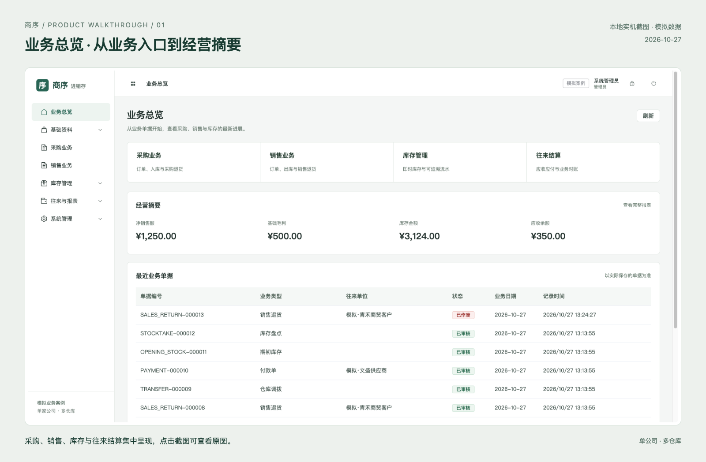

# 商序 · 商贸进销存

<p align="center">
  <a href="https://fxbillu.github.io/side-project-showcase/#journey"></a>
</p>

面向**单公司、多仓库**商贸业务的自主开发案例。连接采购、销售、库存与往来结算，保留可追溯、可复核的业务记录。

**[查看在线展示 ↗](https://fxbillu.github.io/side-project-showcase/#journey)**

[公开验证材料](verification/README.md) · [设计取舍](https://fxbillu.github.io/side-project-showcase/#design)

[](https://fxbillu.github.io/side-project-showcase/#screens)

<sub>实机界面 · 模拟数据 · 点击查看完整流程与可放大的原图</sub>

## 业务如何连起来

**订单 → 分批收发货 → 库存流水 → 往来结算 → 对账与追溯**

| 环节 | 已实现的能力 |
| --- | --- |
| 采购与销售 | 来源订单、分批收发货、退货与退款 |
| 仓库协作 | 分仓库存、仓库调拨、盘点与成本确认 |
| 财务与追溯 | 应收应付、收付款核销、对账报表、资料快照与变更审计 |

管理员、采购、销售、仓库、财务与只读角色按职责操作。

## 三个值得展开的设计

**01 / 分批金额对得上**<br>
3件单价0.335，三次各一件结算为 **0.34 / 0.33 / 0.34**；退货沿用实际来源批次金额。

**02 / 盘盈成本有人确认**<br>
仓库先录数量，管理员或财务明确确认零库存盘盈成本；零价需原因，再按权限审核。

**03 / 历史变化查得到**<br>
审核保存关键资料快照，冲销保留原始与反向流水，资料修改记录前后值。

<sub>Java 21 / Spring Boot / PostgreSQL · Vue 3 / TypeScript / Element Plus</sub>

已有 HTTP 接口契约、OpenAPI 描述与 CSV 交换能力；第三方连接器尚未实现。

## 让结果可核对

> **三组公开算例，可以自己复算。**<br>
> 分仓库存、客户对账、历史批次金额，附原始CSV、API字段摘录、Python标准库脚本与文件哈希。无需访问私有仓库。

**[打开验证摘要 →](https://fxbillu.github.io/side-project-showcase/verification/)** · [查看材料与脚本](verification/README.md) · [下载离线包](https://fxbillu.github.io/side-project-showcase/verification.zip)

**当前状态：** 已实现本地主流程，在线提供静态介绍与截图。全部使用模拟数据，暂无客户签收；实际文件上传、改密及账号变更尚待完整操作验收，完整系统公网 Demo 后续部署。公开算例核对不等于全部功能或生产验收通过。

---

<details>
<summary>网站维护与发布方式</summary>

本公开仓库承载静态展示页；业务源码、完整架构、接口契约、运行部署和完整测试证据在实现仓库维护。

- `index.html`：流程讲解和截图查看器；`assets/`：截图及原图。
- `verification/`：公开验证摘要、模拟数据与离线复算脚本；`verification.zip`：独立材料包。
- `.nojekyll` 保持纯静态发布，`site-manifest.json` 记录发布文件哈希。

在本仓库目录预览：

```bash
python3 -m http.server 8000 --bind 127.0.0.1
```

内容由实现仓库的构建工具生成；先改源文件并验证，再同步结果，普通提交推送`main`，等待Pages部署成功并核对链接。网站使用授权另行确定，当前未指定开源许可证。

</details>
