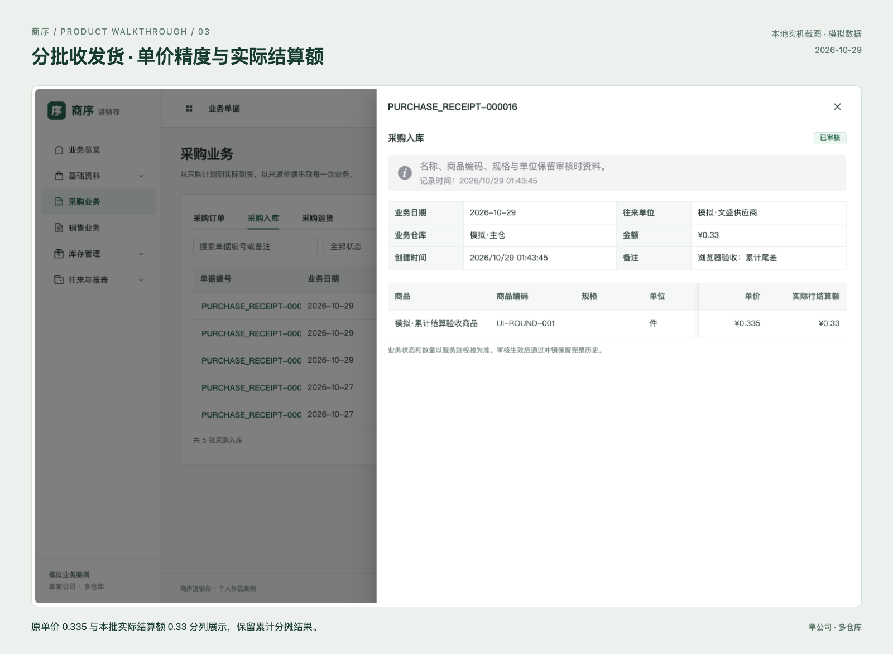

# 商序 · 商贸进销存案例展示

**[打开项目展示 →](https://fxbillu.github.io/side-project-showcase/)** · [设计思路](https://fxbillu.github.io/side-project-showcase/#design) · [接口能力](https://fxbillu.github.io/side-project-showcase/#interfaces) · [验证结果](https://fxbillu.github.io/side-project-showcase/#verification)

单公司、多仓库商贸进销存案例，围绕来源单据连接采购销售、分批收发货、退货退款、调拨盘点与往来结算。

## 从业务问题到实现

- **金额分摊**：3 × 0.335 的三批实际结算为 0.34 / 0.33 / 0.34，退货沿用来源批次金额。
- **职责分工**：仓库录盘点数量，管理员或财务确认零库存盘盈成本，再按权限审核。
- **历史追溯**：审核时保存关键资料快照，冲销保留原始与反向流水，变更保留字段前后值。
- **接口边界**：JSON HTTP / OpenAPI / CSV；现有系统采用会话与 CSRF，第三方连接器和机器令牌尚未实现。

## 界面展示

[查看全部六张实机截图](https://fxbillu.github.io/side-project-showcase/#screens) · [分批结算原图](assets/screenshots/settlement-raw.png)。截图来自不同日期的模拟业务快照，展示排版不改变业务数字与状态。

## 验证与边界

四项已发现界面缺陷已修复并回归；35 项具体功能中，31 项有两种真实页面场景或操作方法证据。UI 修复后 22 项组件测试、16 项隔离 API 检查与16份下载 CSV 核对已有通过记录，各层范围不同。

实际文件选择上传、改密及账号创建/启停/角色变更仍待完整操作验收。项目使用模拟数据，暂无客户签收；完整系统的容器和公网运行留待后续验收。

## 部署与版本

本站使用 GitHub Pages 从本仓库 `main` 分支根目录发布，`.nojekyll` 保留纯静态文件。推送新版本后由 GitHub 构建部署；源码与数据库不在此站点运行。

本仓库只包含经整理的公开展示页面与图片，没有业务后端、运行口令或数据库备份。`site-manifest.json` 保存发布文件哈希，可核对版本内容。更新使用普通提交，保留历史。

当前尚未指定开源许可证；公开展示不等于对全部内容作出任意使用授权。
